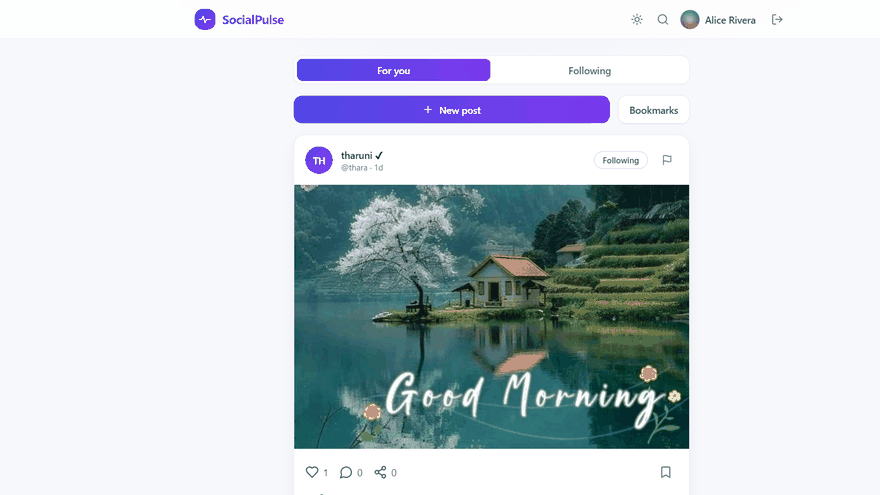
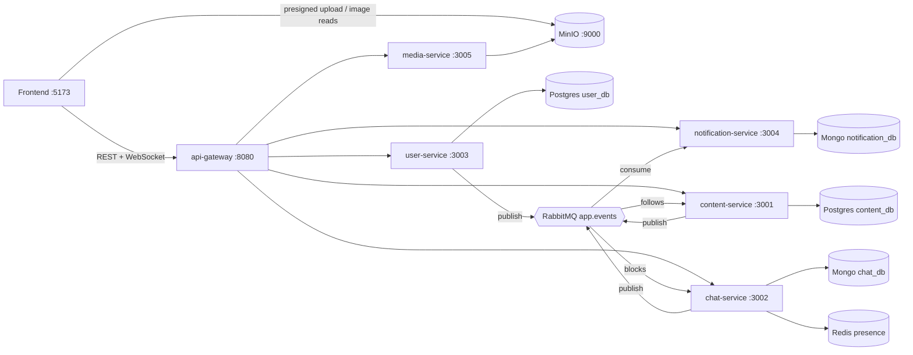

# SocialPulse

A social network with real-time chat: six Node services behind one API gateway, a React frontend, two Postgres databases, Mongo, Redis, RabbitMQ and S3-compatible object storage.

[](https://github.com/THARUNI-GIT/Social_Pulse/actions/workflows/ci.yml)

## Screenshots



| File | Screen |
|---|---|
| `demo.gif` | The four screens below, in sequence |
| `feed.png` | For you timeline with a post image |
| `chat.png` | Direct chat with delivery and read ticks |
| `profile.png` | Profile, follower counts and post grid |
| `admin.png` | Report queue holding a post report |

Captured from a local run on the demo data. Retake them if the layout changes.

## Architecture



The gateway is the only published backend port. It verifies the access token, then proxies REST and Socket.IO to the services. Services own their data and talk to each other through domain events on RabbitMQ.

## Features

Accounts and access
- Register, login, logout with JWT access tokens and rotating refresh tokens.
- Email verification with single-use tokens, resend cooldown, password reset, change password.
- Google sign-in using OAuth 2.0 with PKCE, when client credentials are set.
- Admin suspension that takes effect on the next request, not just at login.
- Blocking enforced on REST and websocket paths.

Feed
- For you and Following timelines with cursor pagination.
- Posts with image or video, hashtags, edit caption, delete, post pages.
- Likes, comments, bookmarks, share to chat, reporting with reasons.

Profiles and discovery
- Avatar upload, bio, follower and following lists, follow buttons.
- Search for people and posts, trending hashtags, hashtag feeds.

Chat
- Direct and group conversations with member management and system events.
- Message persistence before the send is acknowledged, delivery and read ticks, typing, presence, unread badges.
- Reactions, image attachments, sharing a post into a conversation.

Notifications and moderation
- Live bell with grouped likes, comments, follows, messages and moderation outcomes.
- Report queue with remove, keep and restore, plus account suspension.

Media
- Presigned uploads to MinIO with per-kind limits, configured by media-service on startup.

## Tech stack

| Layer | Technology |
|---|---|
| Frontend | React 18, Vite, Tailwind CSS, react-router, socket.io-client, axios, framer-motion |
| Gateway | Node 20, Fastify, JWT verification, in-memory rate limits |
| Services | NestJS 10, Prisma, Mongoose, class-validator |
| Data | PostgreSQL 16, MongoDB 7, Redis 7, RabbitMQ 3, MinIO |
| Auth | RS256 JWT, argon2, OAuth 2.0 with PKCE |
| Runtime | Docker Compose, multi-stage Dockerfiles, nginx, GitHub Actions |

## Quick start

Requirements: Docker with Compose v2, Node 20 for the seed scripts, and port 8080 free.

```sh
cp .env.example .env
sh scripts/gen-keys.sh
docker compose up -d --build
```

Migrations run automatically when the Prisma containers start.

| URL | What |
|---|---|
| http://localhost:5173 | Web app |
| http://localhost:8080 | API gateway |
| http://localhost:9000 | Object storage |
| http://localhost:9001 | MinIO console |
| http://localhost:15672 | RabbitMQ console |

If 8080 is taken, set `GATEWAY_PORT` and `PUBLIC_API_URL` in `.env` and rebuild the frontend with `docker compose up -d --build frontend`, because the API URL is compiled into the bundle.

Demo accounts exist only in your local database: `alice`, `bob`, `carol`, `dave`, `emma`, `frank`, and `admin`, all with password `password123`. The walkthrough is in [docs/DEMO.md](docs/DEMO.md).

Configuration reference: [docs/ENVIRONMENT.md](docs/ENVIRONMENT.md).

## Tests

```sh
cd user-service        && npm test   # 33 tests
cd content-service     && npm test   # 19 tests
cd chat-service        && npm test   # 22 tests
cd notification-service && npm test  # 9 tests
cd media-service       && npm test   # 11 tests
cd api-gateway         && npm test   # 12 tests
cd socialpulse         && npm run build
```

106 tests across the six services. These counts are from a run on this repository, not estimates.

With the stack running:

```sh
GATEWAY=http://localhost:8080 node scripts/e2e.mjs
GATEWAY=http://localhost:8080 node socialpulse/scripts/verify-features.mjs
```

The scripts create posts and accounts, so re-seed after running them.

## Design decisions

- The gateway strips any client-supplied `x-user-id` and `x-user-roles` headers and injects its own after verifying the token. A caller cannot claim another identity by adding headers.
- Refresh tokens are stored hashed and rotated on every use. Reusing an old token revokes all sessions for that user.
- Media bypasses the services. The browser asks media-service for a presigned POST policy, uploads straight to MinIO, and content-service only accepts URLs inside its own bucket.
- Follows and blocks are published as events and replicated into content and chat. Message sending still calls user-service for an authoritative block check, which covers the replica lag.
- A message is marked delivered when the recipient's socket acknowledges it, not when it is written. Read receipts follow the recipient opening the conversation.
- The frontend bakes the API URL at build time, which keeps the bundle static and served by nginx, at the cost of rebuilding the image when the port changes.

## Documentation

- [docs/DEMO.md](docs/DEMO.md): demo walkthrough and reset commands.
- [docs/OPERATIONS.md](docs/OPERATIONS.md): volumes, migrations, ports, backups, rate limits.
- [docs/ENVIRONMENT.md](docs/ENVIRONMENT.md): every environment variable.
- [CONTRACTS.md](CONTRACTS.md): API and event contracts between services.
- [docs/KNOWN_LIMITS.md](docs/KNOWN_LIMITS.md): what is not implemented.
- [CHANGELOG.md](CHANGELOG.md): release history.

## License

MIT, see [LICENSE](LICENSE).
